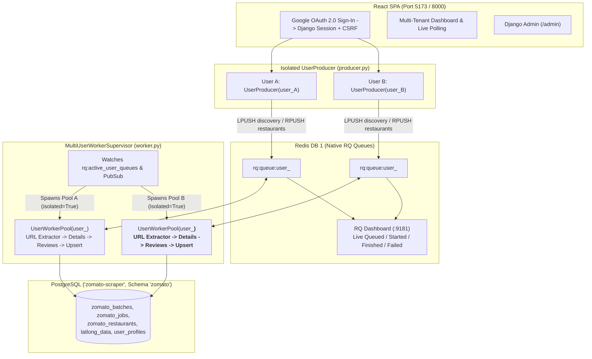

# Zomato-Scraper: Multi-User Isolated Extraction Platform with Per-User Redis Queues, PostgreSQL & Google OAuth

An enterprise-grade, distributed multi-user web scraping, real-time telemetry, and restaurant intelligence platform for Zomato. Built with **Django**, **React (Vite + Tailwind CSS)**, **PostgreSQL** (`zomato-scraper` database, schema `zomato`), **Redis** (DB 1), **Isolated Per-User RQ Worker Pools**, **Google OAuth 2.0**, and **Slack Alerts**.

All operational scripts and verification suites are organized in the [`commands/`](commands/) directory.

---

## Key Features & Architecture

1. **Google OAuth 2.0 & Strict Multi-Tenant Isolation**:
   - Sign in with Google Identity Services (GIS); JWT ID tokens are cryptographically verified in [`backend/scraper_app/auth_views.py`](backend/scraper_app/auth_views.py) via Google's public JWKS keys (`google.oauth2.id_token.verify_oauth2_token`) and bound to HTTP-only Django PostgreSQL sessions (`sessionid`) with CSRF protection (`/api/csrf/`).
   - Every dashboard endpoint (`/api/collection-stats/`, `/api/scrape-status/`, `/api/scrape-data/`, `/api/completed-batches/`, `/api/export-csv/`, `/api/terminate-batch/`, `/api/delete-batch/`) scopes queries strictly to `request.user` and rejects unauthorized cross-user access with **HTTP 403 Forbidden**.
   - Frontend `localStorage` active-request keys are partitioned per user (`zomato_active_request_id_u<userId>`).

2. **Dynamic Per-User Redis Queues (`rq:queue:user_<id>`)**:
   - When an authenticated user starts a pipeline, the platform dynamically allocates an isolated standard RQ list (`rq:queue:user_<id>` in Redis DB 1) with priority discovery tasks (`LPUSH`) and restaurant jobs (`RPUSH`).
   - All pending jobs are natively visible in Redis (`redis-cli -n 1 LRANGE rq:queue:user_<id> 0 -1`) and live in **RQ Dashboard** (`http://127.0.0.1:9181`).
   - Upon completion or termination, empty user queues are automatically purged from Redis RAM and unregistered from RQ Dashboard.

3. **Full End-to-End Isolated Per-User Pipelines**:
   - **`UserProducer`** ([`backend/scraper_app/producers/producer.py`](backend/scraper_app/producers/producer.py)): Isolated per-user request dispatch, URL pushing, and user-scoped queued batch advancement.
   - **`UserURLExtractor`** ([`backend/scraper_app/tasks/url_extractor.py`](backend/scraper_app/tasks/url_extractor.py)): Separate per-user HTTP session (`ZomatoScraper`, geofence cookies, CSRF token) running inside the user's own worker pool.
   - **`UserWorkerPool` & `MultiUserWorkerSupervisor`** ([`backend/scraper_app/workers/worker.py`](backend/scraper_app/workers/worker.py)): Dynamically spawns dedicated OS worker processes (`user-<id>-worker-1..N`) pinned exclusively (`isolated=True`) to each active user's queue, runs per-user `FailedJobsHandler` recovery, and gracefully shuts down workers when that user's queue drains.

4. **Polite Request Delays & 100% Live Scraping**:
   - **General Requests**: `0.4s` delay for pagination and restaurant detail requests.
   - **Reviews Requests**: `1.0s` delay between review pagination requests.
   - **Zero Caching**: Every request performs live location resolution, URL discovery, detail extraction, and review pagination.

5. **Real-Time Slack Alerts**:
   - **Request Completed (`✅`)** & **Low Success Rate (`⚠️` `< 99.0%`)** webhooks with atomic Redis deduplication.

---

## Architecture Flow



---

## Installation & Setup

### 1. Clone & Setup Virtual Environment
```bash
git clone https://github.com/sekharchinta/zomato-scraper.git
cd zomato-scraper

python3 -m venv venv
source venv/bin/activate
pip install -r requirements.txt

cd frontend && npm install && cd ..
```

### 2. Configure Environment Variables
```bash
cp .env.example .env
```
Configure PostgreSQL (`zomato-scraper`, schema `zomato`), Redis DB `1`, `GOOGLE_CLIENT_ID` / `GOOGLE_CLIENT_SECRET`, and optional Slack / LAN origin overrides (`EXTRA_ALLOWED_HOSTS`, `EXTRA_CORS_ORIGINS`, `EXTRA_CSRF_ORIGINS`).

### 3. Setup PostgreSQL Database & Migrate
```sql
CREATE DATABASE "zomato-scraper";
\c "zomato-scraper"
CREATE SCHEMA IF NOT EXISTS zomato;
```
```bash
./commands/migrate.sh
```

---

## Running the Platform

Run the services in separate terminals (with `/home/sekhar/Gamyam/zomato/venv` activated):

| Terminal | Command | Endpoint / Role |
| :--- | :--- | :--- |
| **1. Backend API** | `./commands/run_server.sh` | `http://127.0.0.1:8000` (API + Django Admin `/admin`) |
| **2. Isolated Workers** | `cd backend && ../venv/bin/python manage.py run_workers --workers 6` | Dynamic per-user `UserWorkerPool` supervisor (`--workers-per-user 3`, `--max-total-workers 24`) |
| **3. RQ Monitor** | `./commands/run_rq_dashboard.sh` | `http://127.0.0.1:9181` (Live Redis DB 1 queues & jobs) |
| **4. Frontend (Dev)** | `./commands/run_frontend.sh` | `http://localhost:5173` (Vite dev server with `/api` & `/admin` proxy) |

For production bundle serving directly via Django:
```bash
./commands/build_frontend.sh
```

---

## Sharing on the Same Wi-Fi Network

Because Google Identity Services restricts plain HTTP OAuth logins to `localhost` / `127.0.0.1`:
1. Ensure OpenSSH server is running on the host (`sudo apt install -y openssh-server && sudo systemctl enable --now ssh && sudo ufw allow 22/tcp`).
2. From the teammate's laptop on the same Wi-Fi, forward ports locally:
   ```bash
   ssh -N -L 5173:localhost:5173 -L 9181:localhost:9181 <linux_username>@<host_wifi_ip>
   ```
3. Open `http://localhost:5173` (Dashboard) and `http://localhost:9181` (RQ Monitor) in the teammate's browser.

---

## Repository Structure

```text
zomato/
├── backend/
│   ├── manage.py
│   ├── config.py
│   ├── scraper.py
│   ├── zomato_scraper/              # Settings (CORS, CSRF, PostgreSQL, Redis), URLs, Test Runner
│   ├── scraper_app/
│   │   ├── auth_views.py            # Google OAuth 2.0 JWT verification & Django session auth
│   │   ├── views.py                 # Multi-tenant REST APIs, CSV export, CSRF endpoint
│   │   ├── models.py                # ScrapeBatch, RestaurantJob, RestaurantRecord, LatLongData, UserProfile
│   │   ├── producers/producer.py    # UserProducer & batch dispatch/advancement
│   │   ├── tasks/                   # UserURLExtractor, restaurant_extractor, review_extractor, location_extractor
│   │   └── workers/                 # FairQueue, UserWorkerPool, MultiUserWorkerSupervisor, FailedJobsHandler
│   └── tests/                       # Django API/auth/pipeline tests & scraper unit tests
├── frontend/                        # React SPA (Vite, Tailwind CSS, Lucide React)
├── commands/                        # Lifecycle scripts (run_server, run_workers, run_rq_dashboard, run_tests, etc.)
├── .env.example
└── requirements.txt
```

---

## Running Automated Tests

Run the entire automated test suite across Django APIs, Google OAuth, Slack Alerts, Multi-Tenant Isolation, Dynamic Per-User Queues, Isolated Worker Pools, and Core Scraper Engine:

```bash
./commands/run_tests.sh
```
