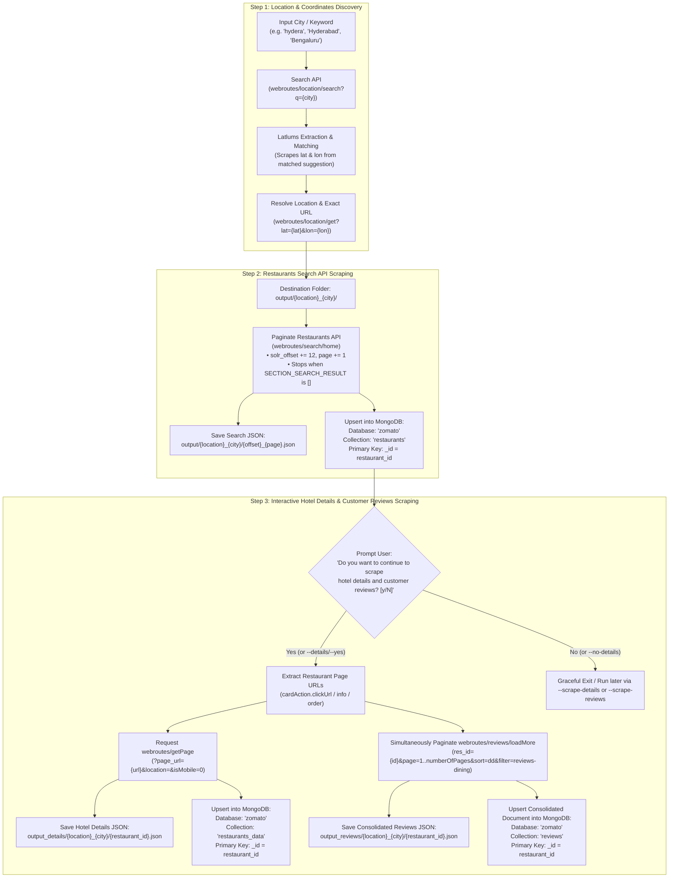

# Zomato Restaurant Scraper (Search, Hotel Details & Reviews with MongoDB Persistence)

A high-performance 3-step scraper for Zomato that accepts **only a city name/keyword** as input, auto-discovers and scrapes the nearest matching **latlums (latitude & longitude)** via Zomato's Search API, paginates the **Restaurants API** until no more restaurants remain (`SECTION_SEARCH_RESULT: []`), asks the user whether to continue, and simultaneously fetches full **Hotel Details** via Zomato's `webroutes/getPage` API and all-page **Customer Reviews** via `webroutes/reviews/loadMore`. All data is persisted to organized JSON folders and MongoDB (`zomato.restaurants`, `zomato.restaurants_data`, and `zomato.reviews`) using **`restaurant_id` as primary key (`_id`)** to guarantee absolute uniqueness.

---

## 3-Step Workflow Overview



---

## Key Features & Architecture

- **Keyword-to-Latlums Discovery**: Query with just `"hydera"` or `"Bengaluru"`. The scraper queries `webroutes/location/search?q={city}`, scores proximity, and auto-scrapes GPS coordinates.
- **Location-Specific Folder Hierarchy**:
  - Search page responses: `output/{location}_{city}/{offset}_{page}.json`
  - Hotel detail responses: `output_details/{location}_{city}/{restaurant_id}.json`
  - Consolidated customer reviews: `output_reviews/{location}_{city}/{restaurant_id}.json`
- **Triple MongoDB Collections (`zomato.restaurants`, `zomato.restaurants_data` & `zomato.reviews`)**:
  - **Database**: `zomato`
  - **Search Collection**: `restaurants` (Stores search index summary, ratings, cost for two, locality)
  - **Details Collection**: `restaurants_data` (Stores full phone numbers, complete address, exact timings, cuisine breakdown, menus, raw payloads)
  - **Reviews Collection**: `reviews` (Stores **all pages** of customer reviews for each restaurant merged into a single consolidated document)
  - **Primary Key (`_id`)**: Set to `restaurant_id` (`resId`) across all collections, strictly preventing duplicate records across runs.
- **Simultaneous Step 3 Execution**: During Step 3, hotel details and all-page customer reviews are extracted simultaneously for each restaurant.
- **Dynamic Review Pagination**: Queries page 1 to read `numberOfPages` (from `page_data.sections.SECTION_REVIEWS.numberOfPages`) and automatically iterates through all available pages (or up to `--reviews-max-pages`).
- **Interactive Step 3 Prompt**: Pauses after extracting restaurants from search results and explicitly asks:
  ```text
  Do you want to continue to scrape hotel details and customer reviews for these N restaurant(s)? [y/N]: 
  ```
  and waits for the user's response before making detail/review requests.
- **Pagination Termination & Solr Loop Detection**:
  - Stops strictly when `SECTION_SEARCH_RESULT: []` is received, safely ignoring false-positive `hasMore: true` flags from Zomato.
  - Automatically detects Solr repeat loops in small localities (when 0 new unique restaurants appear on a page).

---

## Directory Structure

```
zomato/
├── output/                               # Step 2: Search API JSON responses
│   ├── nampally_hyderabad/
│   │   ├── 0_1.json
│   │   └── 12_2.json
│   └── table_space_ub_city_bengaluru/
│       ├── 0_1.json
│       ├── 12_2.json
│       └── 504_43.json
├── output_details/                       # Step 3: Hotel Details JSON responses (webroutes/getPage)
│   ├── nampally_hyderabad/
│   │   ├── 90744.json
│   │   └── 18628825.json
│   └── table_space_ub_city_bengaluru/
│       └── 20527449.json
├── output_reviews/                       # Step 3: Consolidated Customer Reviews (webroutes/reviews/loadMore)
│   ├── nampally_hyderabad/
│   │   ├── 90744.json
│   │   └── 18628825.json
│   └── table_space_ub_city_bengaluru/
│       └── 20527449.json
├── config.py                             # Configuration & environment variables
├── scraper.py                            # Main scraper, MongoDB manager, and CLI
├── .env                                  # Environment variables & MongoDB URI
├── requirements.txt                      # Dependencies (requests, pymongo, dnspython)
├── tests/
│   └── test_scraper.py                   # Automated test suite (29 unit & integration tests)
└── README.md                             # Complete documentation and CLI reference
```

---

## MongoDB Collections & Schemas

### 1. `zomato.restaurants` (Search Collection)
Primary key `_id = restaurant_id`:
```json
{
  "_id": 90744,
  "restaurant_id": 90744,
  "name": "Exotica",
  "city": "Hyderabad",
  "location": "Banjara Hills",
  "locality": "Road 12, Banjara Hills, Hyderabad",
  "rating": "4.6",
  "rating_text": "4.6",
  "rating_subtitle": "Very Good",
  "votes": "12,480",
  "cost_for_two": "₹1,500 for two",
  "cuisines": ["North Indian", "Biryani", "Kebab", "Chinese"],
  "timing": "12noon - 11pm",
  "url": "https://www.zomato.com/hyderabad/exotica-banjara-hills/info",
  "raw_data": { ... },
  "scraped_at": "2026-11-17T02:07:33.123456+00:00"
}
```

### 2. `zomato.restaurants_data` (Hotel Details Collection)
Primary key `_id = restaurant_id`:
```json
{
  "_id": 90744,
  "restaurant_id": 90744,
  "name": "Exotica",
  "city": "Hyderabad",
  "location": "Road 12, Banjara Hills, Hyderabad",
  "locality": "Road 12, Banjara Hills, Hyderabad",
  "address": "5th Floor, 12th Square Building, Road 12, Banjara Hills, Hyderabad",
  "phone_numbers": "+919550515500, +918121585500",
  "cuisines": "North Indian, Biryani, Kebab, Chinese, Oriental, Desserts, Shake, Beverages",
  "timing": "Opens at 12:30pm",
  "rating": "4.6",
  "page_url": "/hyderabad/exotica-banjara-hills/info",
  "canonical_url": "https://www.zomato.com/hyderabad/exotica-banjara-hills",
  "sections": {
    "basic_info": { ... },
    "res_details": { ... },
    "contact": { ... },
    "header_details": { ... },
    "rating_data": { ... }
  },
  "raw_data": { ... },
  "scraped_at": "2026-11-17T02:07:33.456789+00:00"
}
```

### 3. `zomato.reviews` (Consolidated Customer Reviews Collection)
Primary key `_id = restaurant_id`. **All pages of reviews** for a given restaurant are consolidated into this single document to prevent cross-restaurant data mixing:
```json
{
  "_id": 19698425,
  "restaurant_id": 19698425,
  "name": "Shah Ghouse Hotel & Restaurant",
  "city": "Hyderabad",
  "location": "Lakdikapul",
  "page_url": "/hyderabad/shah-ghouse-hotel-restaurant-lakdikapul/reviews",
  "total_reviews": 74,
  "number_of_pages": 15,
  "pages_scraped": 15,
  "reviews": [
    {
      "review_id": 495814088,
      "user_name": "Aaliya Shaikh",
      "user_id": 41210050,
      "user_profile_url": "https://www.zomato.com/users/...",
      "rating": "1",
      "rating_text": "1.0",
      "review_text": "Worst experience ever with cold food...",
      "timestamp": "3 months ago",
      "experience": "dining",
      "like_count": 0,
      "comment_count": 1,
      "review_url": "https://www.zoma.to/LvdNqdv",
      "photos": []
    }
  ],
  "raw_reviews_by_id": {
    "495814088": { ... }
  },
  "ratings": { ... },
  "comments": { ... },
  "raw_pages": [
    { "page": 1, "data": { ... } },
    { "page": 2, "data": { ... } }
  ],
  "scraped_at": "2026-11-17T02:07:34.567890+00:00"
}
```

### 4. `zomato.delivery_data` (Normalized Delivery & Reviews Collection)
Primary key `_id = restaurant_id`. Parsed and consolidated from both `restaurants_data` and `reviews` for clean downstream consumption:
```json
{
  "_id": 90744,
  "restaurant_id": 90744,
  "name": "Exotica",
  "city": "Hyderabad",
  "location": "Banjara Hills, Hyderabad",
  "address": "5th Floor, 12th Square Building, Road 12, Banjara Hills, Hyderabad",
  "phone_numbers": "+919550515500, +918121585500",
  "timing": "Opens at 12:30pm",
  "rating": "4.6",
  "canonical_url": "https://www.zomato.com/hyderabad/exotica-banjara-hills",
  "aggregate_rating": "4.6",
  "votes": "11.5K",
  "delivery_rating": "4.5",
  "reviewcount": "1,775",
  "static_map_url": "https://maps.zomato.com/php/staticmap?center=17.4103,78.4372...",
  "reviews": [
    {
      "user_name": "Tejaswisainama",
      "rating": "5",
      "review_text": "Shivam and binica were excellent",
      "like_count": 0
    },
    {
      "user_name": "Saurav",
      "rating": "5",
      "review_text": "Excellent Food, awesome atmosphere...",
      "like_count": 0
    }
  ],
  "parsed_at": "2026-11-17T06:09:41.470840+00:00"
}
```

---

## CLI Options Reference

| Flag | Short | Type | Description | Default |
| :--- | :--- | :--- | :--- | :--- |
| `--city` | | `str` | Target city name or search keyword (e.g. `hydera`, `Hyderabad`, `Bengaluru`) | From `.env` (`Hyderabad`) |
| `--location` | | `str` | Specific locality/area name (e.g. `Majestic`, `Nampally`, `Indiranagar`) | Auto-resolved from keyword |
| `--lat` | | `float` | Manual latitude override | Auto-scraped via Search API |
| `--lon` | | `float` | Manual longitude override | Auto-scraped via Search API |
| `--all` / `--all-locations` | | `flag` | Extract and scrape all discovered locations with latlums for the city sequentially | `False` |
| `--select` | | `str` | Select location index (1-based) or `'all'` to scrape all locations sequentially | `None` (prompt interactive) |
| `--search-locations`| | `flag` | Lists all matching locations from Search API with ready-to-run commands and exits | `False` |
| `--pages` | | `int` | Maximum search pages to scrape (**omit to scrape all available pages**) | `None` (unlimited) |
| `--details` | `-d` | `flag` | Continue directly to Step 3 (hotel details & reviews) without prompting | `False` |
| `--yes` | `-y` | `flag` | Auto-confirm all prompts (including Step 3 continuation) | `False` |
| `--no-details` | | `flag` | Skip Step 3 hotel details & reviews scraping completely without asking | `False` |
| `--scrape-details` | | `flag` | Standalone mode: Scrape hotel details & reviews for restaurants already in MongoDB | `False` |
| `--restaurant-url` | | `str` | Scrape hotel details & reviews for a single specific restaurant page URL | `None` |
| `--details-limit` | | `int` | Limit the number of restaurants to scrape details & reviews for (e.g. `10`) | `None` (all) |
| `--sync-details-mongo`| | `flag` | Sync all saved hotel details & reviews from disk into MongoDB collections | `False` |
| `--sync-delivery` / `--parse-delivery` | | `flag` | Parse details & reviews into MongoDB collection 'delivery_data' and output_delivery/ | `False` |
| `--sync-mongo` | | `flag` | Sync all search JSON response files from `output/` into `restaurants` | `False` |
| `--start-page` | | `int` | Initial page number to start pagination | `1` |
| `--start-offset`| | `int` | Initial Solr offset value to start pagination | `0` |
| `--check-status`| | `flag` | Runs pre-flight check to verify APIs and MongoDB status | `False` |
| `--parse` | | `flag` | Parses and displays structured restaurant preview | `False` |
| `--no-mongo` | | `flag` | Disables MongoDB storage for the run | `False` |
| `--mongo-uri` | | `str` | Custom MongoDB connection URI | `mongodb://localhost:27017/` |

---

## All Commands Reference

### 1. Location Discovery & Command Generator
When you enter a city or location search without coordinates, the scraper queries Zomato's Search API and prints all available locations with their exact latlums formatted as ready-to-run commands:

```bash
# List all locations for Bengaluru with ready-to-run commands
python3 scraper.py --city "Bengaluru"

# List all locations for Hyderabad
python3 scraper.py --city "Hyderabad"

# Search a specific locality or landmark across locations
python3 scraper.py --location "Majestic" --city "Bengaluru"

# Explicitly search and list locations without prompting
python3 scraper.py --city "Bengaluru" --search-locations

# Directly pick location #2 from the Search API list to scrape immediately
python3 scraper.py --city "Bengaluru" --select 2 --pages 5
```

---

### 1.1 Extract & Scrape All Discovered Locations at Once (`--all` or Option at End)
At the bottom of the location suggestions list, the scraper prints a special option to extract and sequentially scrape **all** discovered locations with latlums for that city:

```text
[1] Location: Bengaluru
    Command:  python3 scraper.py --location "Bengaluru" --city "Bengaluru" --lat 12.971606 --lon 77.594376

[2] Location: SMVT Bengaluru
    Command:  python3 scraper.py --location "SMVT Bengaluru" --city "Bengaluru" --lat 13.000274 --lon 77.641070
...
[25] ALL LOCATIONS: Extract & Scrape All 24 Locations Sequentially
    Command:  python3 scraper.py --city "Bengaluru" --all
```

You can trigger batch scraping across all locations in any of the following ways:
- **Interactive selection**: Type the last option number (e.g. `25`) or type `all` at the prompt.
- **CLI flag `--all` / `--all-locations`**:
  ```bash
  # Scrape all discovered locations for Bengaluru sequentially
  python3 scraper.py --city "Bengaluru" --all

  # Scrape all discovered locations (limit 2 pages per location) and auto-confirm Step 3
  python3 scraper.py --city "Bengaluru" --all --pages 2 --yes

  # Scrape all discovered locations for search results only (skip details & reviews)
  python3 scraper.py --city "Bengaluru" --all --pages 2 --no-details
  ```
- **CLI selection `--select all`**:
  ```bash
  python3 scraper.py --city "Bengaluru" --select all
  ```

**What happens during batch scraping:**
1. Discovered location latlums are saved to `output/{city_slug}_locations.json`.
2. For each location, search results are saved to `output/{location}_{city}/{offset}_{page}.json` and upserted to MongoDB `zomato.restaurants`.
3. Simultaneously scrapes hotel details to `output_details/` and all-page customer reviews to `output_reviews/` and MongoDB `restaurants_data` and `reviews`.
4. Prompts **once** at the beginning for Step 3 confirmation so you are not interrupted between locations.
5. Displays progress banners `[idx/total]` and a final batch summary with MongoDB counts.

---

### 2. Pre-flight API & MongoDB Status Check Commands
Verifies Search API, Restaurants API, and MongoDB connection (`zomato.restaurants` and `zomato.restaurants_data`) before scraping:

```bash
# Check status using default city from .env
python3 scraper.py --check-status

# Check status for a specific city
python3 scraper.py --city "Hyderabad" --check-status

# Check status for a city keyword prefix (e.g. 'hydera')
python3 scraper.py --city "hydera" --check-status

# Check status for a specific locality in a city
python3 scraper.py --city "Bengaluru" --location "Majestic" --check-status
```

---

### 3. Step 2 Search Scraping (Continuous & Limited)
Scrapes pages of restaurants from Search API (`webroutes/search/home`) until `SECTION_SEARCH_RESULT: []` is reached. Automatically writes JSON responses into `output/{location}_{city}/{offset}_{page}.json` and upserts unique restaurants into MongoDB `zomato.restaurants`:

```bash
# Scrape all available pages for Bengaluru (interactive prompt follows for Step 3)
python3 scraper.py --city "Bengaluru"

# Scrape all available pages for Nampally in Hyderabad
python3 scraper.py --city "Hyderabad" --location "Nampally"

# Scrape using exact coordinates
python3 scraper.py --location "Bengaluru" --city "Bengaluru" --lat 12.971606 --lon 77.594376

# Scrape first 5 pages (Offsets: 0, 12, 24, 36, 48)
python3 scraper.py --city "Hyderabad" --pages 5

# Scrape exactly 1 page
python3 scraper.py --city "Bengaluru" --pages 1

# Start from Page 5 with Offset 48 and scrape 5 pages
python3 scraper.py --city "Bengaluru" --start-page 5 --start-offset 48 --pages 5
```

---

### 4. Step 3 Hotel Details & Customer Reviews Scraping
> Customer reviews across **all pages** are scraped **automatically** whenever restaurants/hotel details are scraped. No separate review command is required!

#### A. Interactive Continuation (Default)
After extracting restaurants from Step 2, the scraper pauses and asks:
```text
==========================================================================================
             STEP 3: HOTEL DETAILS & REVIEWS SCRAPING
==========================================================================================
Extracted 504 unique restaurant(s) from search results.
Next: Scrape full hotel details (contact phone, full address, timings, rating)
      via: https://www.zomato.com/webroutes/getPage
      and customer reviews across all pages via: https://www.zomato.com/webroutes/reviews/loadMore
Details Folder:      output_details/nampally_hyderabad/
Reviews Folder:      output_reviews/nampally_hyderabad/
MongoDB Collections: zomato.restaurants_data
                     zomato.reviews
==========================================================================================

Do you want to continue to scrape hotel details and customer reviews for these 504 restaurant(s)? [y/N]: 
```
- Type **`y`** or **`yes`**: Proceeds to simultaneously fetch full hotel details AND all customer review pages for all extracted restaurants automatically.
- Press **Enter** or type **`n`**: Skips Step 3 and exits cleanly.

```bash
# Runs Step 2 search and prompts [y/N] to proceed to Step 3 (details + reviews)
python3 scraper.py --city "Hyderabad" --location "Nampally" --pages 2
```

#### B. Direct Auto-Continue (`--details` / `-d` or `--yes` / `-y`)
Bypasses the interactive prompt and directly scrapes both hotel details and reviews immediately after search extraction:

```bash
# Scrape search results and automatically continue to scrape hotel details and reviews
python3 scraper.py --city "Hyderabad" --location "Nampally" --pages 2 --details

# Same with shorthand flags
python3 scraper.py --city "Hyderabad" --pages 3 -d -y
```

#### C. Skip Step 3 Completely (`--no-details`)
Skips Step 3 completely without asking:

```bash
# Scrape search results only, skip hotel details and reviews without prompt
python3 scraper.py --city "Hyderabad" --pages 5 --no-details
```

#### D. Standalone Hotel Details & Reviews Scraper (`--scrape-details`)
Fetches hotel details AND all customer review pages for restaurants that were already saved into MongoDB `zomato.restaurants`:

```bash
# Scrape hotel details & reviews for all unscraped restaurants in MongoDB
python3 scraper.py --scrape-details

# Scrape hotel details & reviews for a specific city with auto-confirmation
python3 scraper.py --scrape-details --city "Hyderabad" --yes

# Scrape hotel details & reviews for the first 10 restaurants only
python3 scraper.py --scrape-details --city "Hyderabad" --details-limit 10 --yes
```

#### E. Single Restaurant URL Scraper (`--restaurant-url`)
Fetches hotel details and customer reviews across all pages for a single specific restaurant URL:

```bash
# Scrape single hotel details and all review pages directly by URL
python3 scraper.py --restaurant-url "/hyderabad/exotica-banjara-hills/info"

# Scrape single hotel with city & location metadata
python3 scraper.py --restaurant-url "/bangalore/punjab-grill-brigade-road-bangalore/info" --city "Bengaluru" --location "Brigade Road"
```

---

### 5. MongoDB Synchronization Commands

#### Sync Search Responses into `restaurants` collection:
Backfills previously saved search files from `output/*/*.json` into `zomato.restaurants`:
```bash
python3 scraper.py --sync-mongo
```

#### Sync Hotel Details & Reviews into MongoDB collections:
Backfills previously saved hotel detail files (`output_details/`) into `zomato.restaurants_data` AND customer review files (`output_reviews/`) into `zomato.reviews` automatically:
```bash
python3 scraper.py --sync-details-mongo
```

#### Sync & Parse into `delivery_data` collection and `output_delivery/`:
Normalizes and parses all existing hotel details and customer reviews into MongoDB collection `delivery_data` and writes standardized JSON files to `output_delivery/`:
```bash
# Using dedicated parser utility
python3 parse_delivery.py

# Using dedicated parser with preview of parsed fields
python3 parse_delivery.py --preview

# Filter by city or limit
python3 parse_delivery.py --city "Palakollu" --limit 50

# Using scraper CLI flag
python3 scraper.py --sync-delivery
```

---

### 6. Running Without MongoDB (`--no-mongo`)
Saves responses strictly to disk JSON files without requiring a MongoDB connection:

```bash
# Scrape search results without MongoDB
python3 scraper.py --city "Hyderabad" --pages 2 --no-mongo

# Scrape search results, hotel details, and reviews to disk only
python3 scraper.py --city "Hyderabad" --pages 1 --details --no-mongo
```

---

### 7. Scrape and Preview Parsed Results (`--parse`)
Displays a structured preview of restaurant attributes in the terminal:

```bash
python3 scraper.py --city "Bengaluru" --pages 2 --parse
```

---

### 8. Querying MongoDB Collections

Inspect your unique records in MongoDB using Python or MongoDB Shell (`mongosh`):

```python
import pymongo

client = pymongo.MongoClient("mongodb://localhost:27017/")
db = client["zomato"]

# 1. Search Collection (zomato.restaurants)
res_col = db["restaurants"]
print("Total Search Restaurants:", res_col.count_documents({}))

# 2. Hotel Details Collection (zomato.restaurants_data)
details_col = db["restaurants_data"]
print("Total Hotel Details:", details_col.count_documents({}))

# 3. Customer Reviews Collection (zomato.reviews)
reviews_col = db["reviews"]
print("Total Restaurant Reviews:", reviews_col.count_documents({}))

# 4. Query hotel details by primary key (_id = restaurant_id)
hotel = details_col.find_one({"_id": 90744})
if hotel:
    print("Hotel Name:    ", hotel["name"])
    print("Full Address:  ", hotel["address"])
    print("Phone Numbers: ", hotel["phone_numbers"])
    print("Cuisines:      ", hotel["cuisines"])
    print("Timing:        ", hotel["timing"])
    print("Rating:        ", hotel["rating"])

# 5. Query customer reviews for a restaurant (_id = restaurant_id)
review_doc = reviews_col.find_one({"_id": 19698425})
if review_doc:
    print("Restaurant:     ", review_doc["name"])
    print("Total Reviews:  ", review_doc["total_reviews"])
    print("Number of Pages:", review_doc["number_of_pages"])
    for rev in review_doc["reviews"][:3]:
        print(f"  - [{rev['rating']}★] {rev['user_name']}: {rev['review_text'][:80]}...")
```

---

### 9. Background Execution & Log Monitoring Commands
Recommended for running long/unlimited scrapes without keeping the terminal open:

```bash
# Run full scrape in the background with auto-confirm hotel details & reviews (-d -y)
nohup python3 scraper.py --city "Hyderabad" --location "Nampally" -d -y > scraper.log 2>&1 &

# Monitor live progress in another terminal
tail -f scraper.log

# Check running processes
ps aux | grep scraper.py

# Terminate running scraper
pkill -f "python3 scraper.py"
```

---

### 10. Pagination Termination & Stop Conditions
1. **Empty Result Detection**: Stops immediately when `SECTION_SEARCH_RESULT: []` is received. Zomato has a hard display ceiling of ~501 restaurants (`total_restaurants_shown >= 501`). Beyond this limit, Zomato returns `SECTION_SEARCH_RESULT: []` and `entities: []`, while deceptively setting `hasMore: true` and `totalResults: 12741`. The scraper deliberately ignores `hasMore` and terminates on `SECTION_SEARCH_RESULT: []`.
2. **Solr Wrap-around Loop Detection**: In small localities with fewer restaurants, Solr loops and serves duplicate restaurants across higher offsets. The scraper tracks unique restaurant IDs across the session (`session_seen_res_ids`) and halts when a page yields 0 new unique restaurants.

---

### 11. Automated Test Suite
Runs the 29 unit and integration tests covering keyword proximity matching, coordinate auto-discovery, pagination increments, empty `SECTION_SEARCH_RESULT: []` stopping condition with `hasMore: true`, Solr wrap-around detection, `webroutes/getPage` hotel details extraction, `webroutes/reviews/loadMore` dynamic all-page customer reviews extraction, MongoDB unique primary key upserts, and folder syncing:

```bash
# Run all tests with verbose output
python3 -m unittest -v tests/test_scraper.py

# Run all test discovery
python3 -m unittest discover tests
```
