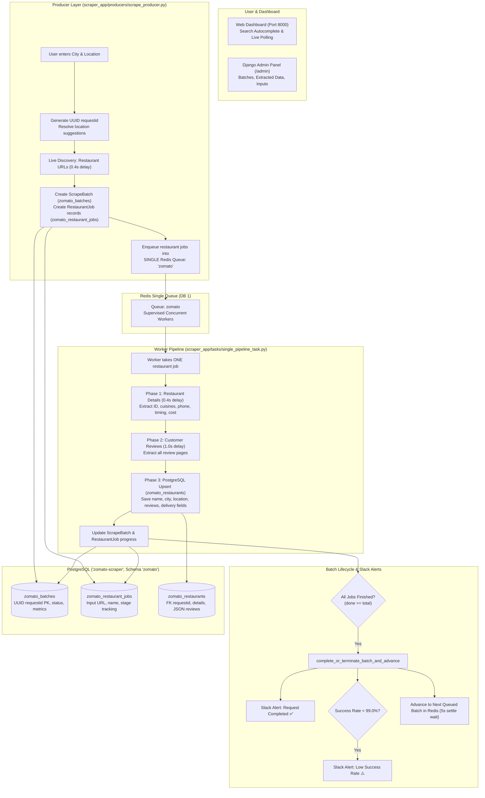

# Zomato-Scraper: Distributed Platform with Single Redis Queue, PostgreSQL & Slack Alerts

An enterprise-grade, distributed web scraping, real-time monitoring, and data extraction platform for Zomato. Built with **Django**, **PostgreSQL** (`zomato-scraper` database, schema `zomato`), **Redis** (DB 1), **RQ (Redis Queue) Workers**, and **Slack Alerts**.

This platform is powered by a **Single Redis Queue** (`zomato`) and a **streamlined per-restaurant worker pipeline**. It persists data into PostgreSQL tables managed strictly by Django models, tracks every scrape batch with a unique **UUID `requestid`**, extracts multi-page customer reviews with a 1.0-second delay, uses a 0.4-second delay for all other requests, enforces **100% live scraping** (zero caching), provides automatic retry and stage recovery, sends **Slack alerts** upon request completion and low success rate (< 99%), and features an uncluttered live dashboard with CSV export and an admin management panel.

All operational execution scripts are organized in the [`commands/`](commands/) directory.

---

## Key Features & Architectural Principles

1. **Strictly Single Redis Queue (`zomato`)**: Only one queue named `zomato` exists in Redis (DB 1). All restaurant jobs are submitted to and processed from this single queue sequentially per batch.
2. **Polite Request Delays**:
   - **General Requests**: `0.4s` delay between pagination and restaurant details requests to avoid rate limits while maintaining high throughput.
   - **Reviews Requests**: `1.0s` delay between review page requests to reliably extract full review histories without trigger-blocking or 401s.
3. **100% Live Scraping (Zero Caching)**: Caching is completely eliminated. Because menus, ratings, offers, and delivery statuses change between morning, afternoon, and evening, every search triggers live discovery and fresh extraction.
4. **PostgreSQL Database (`zomato-scraper`, Schema `zomato`)**:
   - Primary tables: `zomato_batches` (UUID PK `requestid`) and `zomato_restaurants` (FK `requestid`).
   - Zero SQLite, Zero MongoDB. Managed strictly via Django models.
5. **Real-time Slack Alerts**:
   - **Request Completed Alert (`✅`)**: Dispatched immediately upon batch completion with full scrape metrics and timestamps.
   - **Low Job Success Rate Alert (`⚠️`)**: Dispatched when $\text{Success Rate} < 99.0\%$, alerting if more than 1% of jobs fail.
   - Fail-safe, non-blocking delivery with atomic Redis deduplication.
6. **Clean Django Admin Interface**:
   - Registered sections: **Batches**, **Jobs (Extracted Data)**, and **Inputs**.
   - Clean, standard plain-text display (no custom inline colors, effects, badges, or external links).
   - Search by request UUID returns all records for that request. Status filtering enabled.
7. **Commands Directory**: All execution commands for running the web server, workers, dashboard, migrations, tests, and maintenance tasks reside in [`commands/`](commands/).

---

## Architecture Flow



---

## Database Schema

Database: **`zomato-scraper`** | Schema: **`zomato`**

### 1. `zomato_batches` (`ScrapeBatch` Model)
| Column | Type | Description |
| :--- | :--- | :--- |
| `requestid` | `UUID` | **Primary Key**: Unique UUID identifying the scrape request batch |
| `city` | `VARCHAR(100)` | Target city |
| `location` | `VARCHAR(200)` | Target location / locality |
| `status` | `VARCHAR(50)` | Batch state (`queued`, `in_progress`, `completed`, `terminated`, `failed`) |
| `progress` | `INTEGER` | Real-time percentage completion (0-100%) |
| `total_restaurants` | `INTEGER` | Total discovered restaurant jobs |
| `parsed_delivery` | `INTEGER` | Completed delivery schema parsed count |
| `completed_jobs` | `INTEGER` | Successfully extracted jobs |
| `failed_jobs` | `INTEGER` | Failed jobs count |
| `fields` | `JSONB` | User-selected extraction fields |
| `created_at` | `TIMESTAMP` | Timestamp when request was submitted |
| `started_at` | `TIMESTAMP` | Timestamp when workers began extraction |
| `completed_at` | `TIMESTAMP` | Timestamp when batch completed |

### 2. `zomato_restaurants` (`RestaurantRecord` Model)
| Column | Type | Description |
| :--- | :--- | :--- |
| `id` | `BIGSERIAL` | **Primary Key** |
| `requestid` | `UUID` | **Foreign Key** &rarr; `zomato_batches.requestid` |
| `name` | `VARCHAR(255)` | Restaurant name |
| `city` | `VARCHAR(100)` | City |
| `location` | `VARCHAR(200)` | Location / locality |
| `pageurl` | `TEXT` | Relative Zomato URL path |
| `canonical_url` | `TEXT` | Canonical web URL |
| `phone_number` | `TEXT` | Contact phone numbers |
| `address` | `TEXT` | Street address |
| `cuisines` | `TEXT` | Comma-separated cuisines |
| `timing` | `TEXT` | Operational hours |
| `rating` | `VARCHAR(20)` | Aggregate rating (e.g. `4.2`) |
| `votes` | `INTEGER` | Rating vote count |
| `costof_two` | `VARCHAR(100)` | Cost for two text |
| `total_reviews` | `INTEGER` | Number of reviews collected |
| `reviews` | `JSONB` | Structured customer reviews array (user, rating, text, likes) |
| `status` | `VARCHAR(50)` | Record extraction status (`completed`, `failed_all_retries`) |
| `scraped_at` | `TIMESTAMP` | Timestamp of extraction |

### 3. `zomato_restaurant_jobs` (`RestaurantJob` Model)
| Column | Type | Description |
| :--- | :--- | :--- |
| `id` | `BIGSERIAL` | Primary Key |
| `batch_id` | `UUID` | Foreign Key &rarr; `zomato_batches.requestid` |
| `name` | `VARCHAR(255)` | Restaurant name |
| `page_url` | `TEXT` | Input URL path |
| `stage` | `VARCHAR(50)` | Granular stage (`pending`, `processing_details`, `processing_reviews`, `completed`, `failed_all_retries`) |
| `last_review_page` | `INTEGER` | Checkpoint for resuming review pagination |
| `created_at`, `updated_at`| `TIMESTAMP` | Record timestamps |

---

## Slack Alerts Integration

The platform provides automated notifications to Slack via **Incoming Webhook**:

1. **Request Completed Alert (`✅`)**:
   - Sent automatically when a batch finishes processing all restaurants (`status == 'completed'`).
   - Details: Batch ID, City, Location, Status, Success Rate, Completed/Total counts, Failed count, Timestamp.
2. **Low Job Success Rate Alert (`⚠️`)**:
   - Sent when $\text{Success Rate} = (\text{completed\_jobs} / \text{total\_restaurants}) \times 100.0 < 99.0\%$.
   - Details: Batch ID, City, Location, Actual Success Rate vs $99.0\%$ threshold, Failed jobs count.

### Configuring Slack Alerts
In your `.env` file, configure your Slack Incoming Webhook URL:
```ini
SLACK_WEBHOOK_URL=https://hooks.slack.com/services/YOUR/WEBHOOK/URL
SLACK_ALERT_ENABLED=true
SLACK_MIN_SUCCESS_RATE=99.0
```

### Testing Slack Alerts CLI
You can test alert delivery at any time from your terminal:
```bash
# Test Request Completed alert
python manage.py test_slack_alert --type=completed

# Test Low Success Rate alert (< 99%)
python manage.py test_slack_alert --type=low_success
```

---

## Django Admin Panel (`/admin`)

The Django Admin interface is customized for monitoring and auditing:

| Section Name | Description | Key Features |
| :--- | :--- | :--- |
| **Batches** | Scrape batch tracking table | Displays Request ID, City, Location, Status, Progress, Total, Completed, Failed, and Timestamps. Filter by status, city, date. |
| **Jobs (Extracted Data)** | Extracted restaurant records | Displays all extracted columns (Name, City, Location, Rating, Votes, Cost for Two, Cuisines, Phone, URLs, Reviews count, Status, Scraped At). **Search by Request UUID** returns all records for that request. Status filter enabled. |
| **Inputs** | Raw input URLs and names | Streamlined table displaying Input URL (`page_url`), restaurant Name, associated Request ID, and Status. |

> **Clean Plain-Text UI**: All custom colors, effects, badges, and external links are removed in favor of clean, standard, accessible plain text.

---

## Installation & Setup

### 1. Clone & Setup Virtual Environment
```bash
git clone https://github.com/sekharchinta/zomato-scraper.git
cd zomato-scraper

# Create and activate virtual environment
python3 -m venv venv
source venv/bin/activate

# Install dependencies
pip install -r requirements.txt
```

### 2. Configure Environment Variables
Copy the template and configure your local PostgreSQL and Redis credentials:
```bash
cp .env.example .env
```
Edit `.env`:
```ini
REDIS_HOST=127.0.0.1
REDIS_PORT=6379
REDIS_DB=1
SINGLE_QUEUE_NAME=zomato

POSTGRES_HOST=127.0.0.1
POSTGRES_PORT=5432
POSTGRES_DB=zomato-scraper
POSTGRES_USER=postgres
POSTGRES_PASSWORD=your_postgres_password
POSTGRES_SCHEMA=zomato

SLACK_WEBHOOK_URL=https://hooks.slack.com/services/YOUR/WEBHOOK/URL
SLACK_ALERT_ENABLED=true
SLACK_MIN_SUCCESS_RATE=99.0
```

### 3. Setup PostgreSQL Database & Schema
In `psql` (as postgres superuser):
```sql
CREATE DATABASE "zomato-scraper";
\c "zomato-scraper"
CREATE SCHEMA IF NOT EXISTS zomato;
```

### 4. Run Migrations
```bash
./commands/migrate.sh
# Or:
python manage.py migrate
```

---

## Running the Platform

Run the following commands in 3 separate terminal tabs:

```
┌─────────────────────────────────┬─────────────────────────────────┬─────────────────────────────────┐
│           TERMINAL 1            │           TERMINAL 2            │           TERMINAL 3            │
│       Django Web Server         │       Single-Queue Workers      │          RQ Dashboard           │
│                                 │                                 │                                 │
│    ./commands/run_server.sh     │    ./commands/run_workers.sh    │  ./commands/run_rq_dashboard.sh │
│                                 │                                 │                                 │
│    http://127.0.0.1:8000        │    3 Concurrent Workers         │    http://127.0.0.1:9181        │
└─────────────────────────────────┴─────────────────────────────────┴─────────────────────────────────┘
```

- **Dashboard**: `http://127.0.0.1:8000`
- **Admin Panel**: `http://127.0.0.1:8000/admin`
- **RQ Monitor**: `http://127.0.0.1:9181`

---

## Running Automated Tests

Run the full automated test suite (77 tests across Django integration, core scraping engine, and Slack alerts):
```bash
./commands/run_tests.sh
```

- **Django PostgreSQL & Queue Suite**: 33 tests passing.
- **Standalone Core Engine Suite**: 34 tests passing.
- **Slack Alerting Suite**: 10 tests passing.
